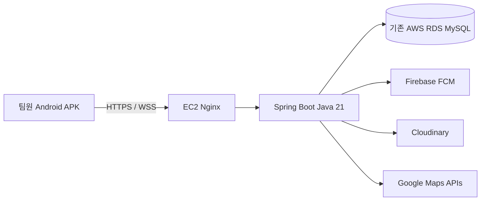

**WeGoTrip 빌드·서버 배포 분석 — 2026-10-31**

목표는 Android APK를 팀원에게 전달해 실기기에서 테스트하는 것이다. 기존 AWS RDS를 유지하고, 백엔드의 공개 HTTPS 주소를 먼저 마련한 다음 그 주소를 포함한 APK를 빌드하는 순서를 권장한다. 현재 코드의 프론트 테스트, 서버 테스트, Android JS/Hermes 번들, 실행형 서버 JAR 생성은 통과했다. EAS 프로젝트 연결과 배포 환경설정은 추가로 필요하다.

**확인한 구조**

| 영역 | 현재 구성 | 배포에 미치는 영향 |
| --- | --- | --- |
| 앱 | Expo ~57.0.20, React Native 0.86.3, React 19.2.3, Expo Router, TypeScript | Expo EAS로 Android APK 생성 가능. 실제 네이티브 컴파일은 별도 검증 필요 |
| 서버 | Spring Boot 4.1.1, Java 21, Gradle 9.7.1 | Java 21 실행 환경에 bootJar 배포 가능 |
| 데이터 | MySQL JDBC, JPA와 JdbcTemplate 혼용 | 기존 RDS를 연결하되 수동 SQL 스키마 적용 상태 확인 필요 |
| 인증 | 자체 JWT, refresh token, 네이티브 SecureStore | Firebase는 로그인 시스템이 아니라 푸시 용도 |
| 채팅 | HTTP API와 /ws/chat WebSocket | HTTPS와 WSS를 함께 프록시해야 함 |
| 푸시 | Firebase Admin, React Native Firebase Messaging, DB outbox | 앱 Firebase 파일과 서버 발송 자격 증명을 각각 설정해야 함 |
| 이미지 | Cloudinary | 기존 Cloudinary 설정을 서버로 이전 |
| 지도 | 서버가 Google Places / Static Maps 프록시 | Google API 키는 서버에 보관 |

여행·친구·파티·일정·장소·경비·정산·준비물·채팅·투표·공지 기능이 구현되어 있다. GPS 위치 공유·OCR·AI는 README상 후속 범위이며 이번 배포의 필수 조건은 아니다.

**이번에 실행한 검증**

| 검사 | 결과 | 범위 |
| --- | --- | --- |
| npm test | 178개 통과 | 프론트 도메인·API 어댑터·푸시 처리 등 |
| npm run typecheck | 통과 | TypeScript 정적 검사 |
| Expo Android export | 통과 | 1,570개 모듈, Android Hermes 번들 및 에셋 |
| Gradle test --rerun | 11개 테스트 스위트, 148개 통과, 실패·오류·스킵 0 | H2 test 프로필에서 실제 재실행 |
| Gradle bootJar | 통과 | backend/build/libs/travel-backend-0.0.1-SNAPSHOT.jar 생성, 약 123 MiB |
| Expo install --check | 오프라인 검사상 변경 불필요 | CLI가 오프라인 검사의 신뢰도 제한을 표시함. 온라인 전체 진단과 구분 |
| APK 설치·실기기 푸시 | 미검증 | EAS 빌드, 네이티브 컴파일 및 실제 기기 검증 필요 |
| AWS 운영 연결 | 미검증 | AWS 콘솔·VPC·보안 그룹·운영 스키마에 직접 접근하지 않음 |

Android export의 첫 시도는 실행 환경의 임시 폴더에 Hermes 출력 파일을 쓰지 못해 실패했다. TEMP/TMP를 작업 폴더 안의 임시 디렉터리로 지정한 재시도에서는 통과했다. 이는 APK 네이티브 빌드 성공을 뜻하지 않는다. 기존 README에는 한글 경로에서 Windows CMake 네이티브 빌드가 실패했던 기록도 있어 첫 APK는 EAS 클라우드 빌드를 권장한다.

**APK 전에 해결할 항목**

1. EAS 프로젝트를 연결하고 frontend/eas.json을 만든다. 현재 resolved Expo config에 extra.eas.projectId가 없고 eas.json도 없다. Android 패키지는 com.jeongheaum.frontend다.
2. EAS preview 환경에 EXPO_PUBLIC_DATA_SOURCE=http를 명시한다. frontend/src/data/repository.ts는 이 값이 없으면 MockTravelRepository를 선택한다. 로컬 .env.local이 Git에서 제외되어 있어 원격 빌드에 자동 전달된다고 가정하면 안 된다.
3. EXPO_PUBLIC_API_URL과 EXPO_PUBLIC_MAPS_API_URL을 모두 배포된 HTTPS 주소로 지정한다. 현재 두 값은 localhost다. 값의 형식은 https://api.example.com/api이며 /api/v1까지 넣으면 클라이언트가 v1을 다시 붙이므로 잘못된 경로가 된다.
4. google-services.json을 EAS 빌드 환경에 제공한다. 로컬 파일이 존재하고 패키지 일치는 확인했다. 파일은 Git에서 제외되어 있다. app.config.js는 파일 존재 여부에 따라 Firebase 플러그인과 pushConfigured.android를 결정하므로 원격 빌드의 resolved config도 확인해야 한다. EAS 파일 환경 변수 GOOGLE_SERVICES_JSON으로 경로를 제공하는 방식이 현재 코드에 맞는다. [EAS 환경 변수와 파일 유형](https://docs.expo.dev/eas/environment-variables/)
5. 앱 서명 키를 정하고 보관한다. 로컬 generated android/app/build.gradle의 release 구성은 현재 debug 서명을 참조한다. EAS에서 native 폴더를 새로 생성하는 경로와 로컬 generated 프로젝트를 직접 빌드하는 경로를 구분하고, 배포용 키로 서명된 APK를 만들어 이후 업데이트에 같은 키를 사용한다.
6. EAS 업로드 범위를 점검한다. 저장소의 tmp 아래에 약 9천 개 파일이 Git 추적 중이며 의존성·보고서 산출물이 포함되어 있다. 루트 .easignore로 backend, tmp, output, 로그 등을 제외하는 구성이 필요하다. .easignore는 저장소의 모든 .gitignore를 대체하므로 node_modules, .env, 네이티브 generated 폴더, 자격 증명 제외 규칙도 함께 보존해야 한다. 로그인 후 eas build:inspect의 archive 단계로 실제 업로드 파일을 검사할 수 있다. [Expo 업로드 제외 규칙](https://docs.expo.dev/build-reference/easignore/)

아래는 후속 설정 시 사용할 preview 프로필 예시다. 이 분석에서는 설정 파일을 생성하거나 EAS 프로젝트를 만들지 않았다.

```json
{
  "build": {
    "preview": {
      "distribution": "internal",
      "environment": "preview",
      "android": { "buildType": "apk" }
    }
  }
}
```

기기 직접 설치에는 APK가 필요하다. EAS의 기본 Android 산출물은 AAB이므로 preview 프로필에서 APK를 명시한다. [Expo APK 빌드 안내](https://docs.expo.dev/build-reference/apk/)

EAS 명령은 앱 디렉터리인 frontend에서 실행하고 eas.json도 그 안에 둔다. [Expo 모노레포 빌드 안내](https://docs.expo.dev/build-reference/build-with-monorepos/)

```powershell
# frontend 디렉터리에서 실행하는 후속 작업 예시
npx eas-cli@latest login
npx eas-cli@latest build:configure
# preview 환경 변수, Firebase 파일, 업로드 제외 규칙, 서명 설정을 완료한 뒤 실행
npx eas-cli@latest build --platform android --profile preview
```

EXPO_PUBLIC 변수는 앱에 포함되는 공개 설정이다. DB 비밀번호, JWT 키, 계좌 암호화 키, Firebase 서비스 계정 private_key, Cloudinary secret을 넣지 않는다. 네이티브 Firebase 클라이언트 설정과 서버 서비스 계정은 별개다. [Expo 환경 변수의 공개 범위](https://docs.expo.dev/eas/environment-variables/)

**권장 서버 배치**



첫 배포는 기존 RDS와 같은 VPC에 EC2 한 대를 두고, Java 21 JAR를 systemd로 상시 실행하며 Nginx에서 HTTPS를 종료하는 구성을 권장한다. Docker를 사용할 경우에도 동일한 단일 서버 구성을 유지할 수 있다. 현재 Dockerfile, Compose, systemd, CI/CD 배포 설정은 확인되지 않았다.

단일 서버를 권장하는 이유는 ChatSocket이 JVM 메모리의 ConcurrentHashMap에 연결을 보관하고 Spring 트랜잭션 이벤트로 변경을 방송하기 때문이다. 여러 JVM에 연결이 나뉘면 다른 서버에서 발생한 변경 이벤트가 해당 연결로 전달되지 않아 즉시 반영이 지연될 수 있다. 향후 수평 확장 시 Redis Pub/Sub 등의 서버 간 이벤트 전달을 설계해야 한다. 푸시 outbox worker와 투표 자동 마감 작업도 주기 실행되므로 상시 실행되는 프로세스가 필요하다.

트래픽이 늘어 관리형 컨테이너 운영으로 옮길 경우 ECS/Fargate와 ALB를 검토할 수 있다. ALB는 WebSocket을 지원한다. [AWS ALB 리스너](https://docs.aws.amazon.com/elasticloadbalancing/latest/application/load-balancer-listeners.html)

서버 배포 설정에는 다음을 포함한다.

- RDS 보안 그룹의 MySQL 포트는 앱 서버 보안 그룹에서 접근하도록 설정한다. EC2와 RDS의 VPC·서브넷·라우팅·보안 그룹을 실제 환경에서 확인한다. [AWS RDS 접근 제어](https://docs.aws.amazon.com/AmazonRDS/latest/UserGuide/Overview.RDSSecurityGroups.html)
- 공개 진입점은 HTTPS이며 Spring Boot의 8080은 프록시 내부에서 사용한다.
- /api/*와 /ws/chat을 모두 프록시하고 경로를 보존한다. 클라이언트는 API URL의 /api를 제거한 뒤 /ws/chat을 만들고 https를 wss로 변환한다. Nginx에는 WebSocket Upgrade/Connection 전달이 필요하다. [Nginx WebSocket 프록시](https://nginx.org/en/docs/http/websocket.html)
- 이미지 업로드에 맞춰 프록시 요청 크기 한도를 설정한다. 현재 서버 파일 한도는 8MB, multipart 요청 한도는 9MB이므로 프록시에는 예를 들어 10m를 설정한다. [Nginx 요청 크기 설정](https://nginx.org/en/docs/http/ngx_http_core_module.html#client_max_body_size)
- 프로세스 자동 재시작, 로그 보관, 이전 JAR로 롤백하는 절차를 마련한다. 서버에서 Gradle을 실행하는 대신 빌드된 JAR를 배포할 수 있다.

**서버 환경설정과 기존 DB**

| 설정 | 현재 확인 상태 | 배포 시 처리 |
| --- | --- | --- |
| DB_URL / DB_USERNAME / DB_PASSWORD | 로컬 .env에 AWS RDS 주소와 값 존재 | 배포 서버에 안전하게 주입하고 네트워크 연결 확인 |
| DB_DDL_AUTO | 별도 값 없음. 코드 기본값 validate | validate 유지. 수동 SQL 테이블도 별도 확인 |
| USER_JWT_SECRET | 설정됨, Base64 디코딩 후 최소 32바이트 | 기존 세션을 유지하려면 같은 키 사용 |
| USER_BANK_ENCRYPTION_KEY | 설정됨, Base64 디코딩 후 32바이트 | 기존 암호문 복호화를 위해 같은 키를 보존 |
| AUTH_COOKIE_SECURE | 로컬 false | HTTPS 배포는 true. 주로 웹 refresh cookie에 영향 |
| GOOGLE_MAPS_API_KEY | 설정됨 | 서버에 주입하고 Places / Static Maps 호출 검증 |
| CLOUDINARY_* | 설정됨 | 서버에 주입하고 실제 사진 업로드 검증 |
| PUSH_ENABLED / FIREBASE_PROJECT_ID | true / 설정됨 | 서버 FCM 자격 증명을 함께 마련 |
| FIREBASE_CREDENTIALS_FILE | 로컬 .env와 프로세스 환경에 명시되지 않음 | 서버 전용 서비스 계정 파일 또는 적절한 ADC 구성 |

로컬에 Google Application Default Credentials 파일이 존재하지만 해당 파일의 유효성이나 권한까지 검증하지는 않았다. FcmPushSender는 별도 자격 증명 경로가 없으면 ADC를 사용한다. AWS 서버에는 로컬 PC의 ADC가 자동으로 존재하지 않으며, PUSH_ENABLED=true만 설정해도 발송 준비가 끝나는 것은 아니다. 코드상 인증 초기화 실패 시 서버가 계속 실행될 수 있으므로 푸시 발송 성공을 따로 확인해야 한다.

현재 JDBC URL에는 TLS 강제·검증 옵션이 명시되어 있지 않다. 실제 암호화 여부는 확인하지 않았으며 배포 시 RDS CA와 호스트 검증을 포함한 연결 구성을 확인한다.

DB 마이그레이션은 backend/db/migrations의 SQL 001~015로 관리되며 Flyway/Liquibase 자동 실행 설정은 없다. 번호 순서 전체를 새로 일괄 실행하면 안 된다. 예를 들어 010과 011은 신규/기존 채팅 스키마에 따라 적용 대상이 다르다. 문서에는 012·013·015 적용 완료 기록이 있으나 이번 분석에서는 운영 DB를 조회하지 않았다. 현재 DB의 실제 테이블·컬럼·인덱스와 최신 코드의 요구사항을 읽기 전용으로 대조한 뒤 누락분만 판단해야 한다.

특히 014의 push_event/push_delivery와 015의 trip_notice를 확인한다. 여행·채팅 등은 JdbcTemplate의 수동 SQL을 많이 사용하므로 Hibernate validate 성공만으로 전체 테이블이 준비되었다고 볼 수 없다. /api/test는 고정 문자열을 반환하므로 DB·FCM 준비 상태를 확인하는 health check도 아니다. 필요하면 제한된 readiness 검사를 추가한다.

**테스트 목표에서의 우선순위**

1. 배포 대상 EC2와 API 도메인을 결정하고 기존 RDS의 VPC·보안 그룹·스키마를 확인한다.
2. 서버 환경 변수와 FCM 인증을 주입하고 JAR를 실행한다.
3. HTTPS/WSS, 서버 재시작, 로그인·채팅·사진·지도·공지 API를 확인한다.
4. EAS preview 환경, Firebase 파일, 업로드 제외 규칙, 서명 키를 설정한다.
5. preview APK를 빌드해 실기기 두 대에 설치한다. 이 APK는 Metro 개발 서버 없이 실행되는 배포용 preview 빌드로 구성한다.
6. 서로 다른 계정으로 같은 여행에 참여해 채팅 즉시 반영, 사진 전송, 재로그인, 앱 재실행, 투표 자동 마감, 백그라운드 푸시와 알림 탭 이동을 확인한다. 테스트 데이터가 기존 RDS에 기록되는 점을 전제로 테스트용 계정을 사용한다.

Android APK만 목표인 현 단계에서는 iOS 서명·APNs, 스토어 제출, 웹 호스팅, OTA 업데이트, 다중 서버 확장은 후속 작업으로 둘 수 있다. 단, 웹도 배포한다면 users.allowed-origins와 maps.allowed-origins를 실제 웹 origin으로 설정하고, refresh cookie가 SameSite=Strict이므로 프론트/API의 사이트 구성을 함께 검토해야 한다.

추가 운영 보완으로 지도 프록시를 점검할 필요가 있다. 현재 /api/maps는 인증 없이 접근 가능하고 프로세스 전체 검색 30회/분·이미지 120회/분으로 제한하는 개발용 구성이 있다. 공개 운영에서는 팀원의 정상 요청과 외부 요청이 같은 한도를 공유하므로 사용자별 제한·접근 제어·Google API 할당량 정책을 검토한다.

후속 실행에 필요한 미확정 정보는 기존/신규 EC2 여부, RDS와 서버의 VPC·보안 그룹, 사용할 API 도메인, Expo 계정/프로젝트, 서버 FCM 자격 증명의 제공 방식이다. 이번 작업에서 애플리케이션 코드는 수정하지 않았으며 검증은 H2 테스트 DB와 로컬 빌드로 수행했다.
