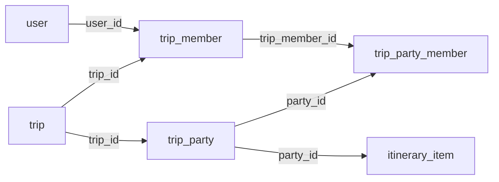

# 여행 내 소그룹(파티) 구현 정리

작성 기준: 2026-09-27 현재 코드. 검증 결과는 구현 완료 당시 실행 결과를 기준으로 한다.

## 1. 기능 정의와 구현 범위

파티는 **하나의 여행에 참여한 멤버 일부를 묶는 소그룹**이다. 특정 날짜나 시간에 열리는 행사나 별도 여행방이 아니다.

예를 들어 여행 멤버가 지우·민수·서연·도윤이라면 지우·서연을 카페팀으로, 민수·도윤을 산책팀으로 지정할 수 있다. 같은 소그룹을 여행 기간의 여러 날짜 일정과 지출에 선택할 수 있다.

- 파티 이름과 소속 멤버의 조회·생성·수정·삭제를 지원한다.
- 한 사용자가 같은 여행의 여러 파티에 속할 수 있다.
- 파티 자체에는 날짜·시작 시간·종료 시간이 없다. 일정에는 날짜와 시간이 유지된다.
- 파티 이름·멤버는 서버에서 공유한다. 일정·지출 자체의 서버 동기화는 이번 구현 범위에 포함하지 않는다.

## 2. 변경 제약과 반영 내역

| 구분 | 반영 내용 |
| --- | --- |
| DB | 실제 MySQL의 테이블·컬럼·외래키를 읽기 전용으로 확인하고 기존 구조 사용 |
| DB 스키마·기존 데이터 | 구현·검증 과정에서 변경하지 않음. 마이그레이션 없음 |
| 프론트엔드 UI | 승인받은 파티 날짜·시간 입력 및 목록 표시 제거, 저장 안내 문구 수정만 반영 |
| 기존 디자인 | 이름·멤버 선택, 저장·수정·삭제 및 파티별 일정 화면 배치 유지 |
| 프론트엔드 로직 | HTTP 저장소를 파티 API에 연결하고 파티 활동일·시간 제한 제거 |
| 테스트 DB | 기존 테이블 구조를 재현한 별도 H2 메모리 DB 사용 |

DB를 변경하지 않았다는 것은 스키마 변경이나 구현 중 실사용 데이터 수정을 하지 않았다는 의미다. 완성된 기능을 사용해 파티를 생성·수정·삭제하면 기존 테이블에 해당 데이터가 저장된다.

## 3. 기존 DB 구조

### trip_party

| 컬럼 | 타입 | 역할 |
| --- | --- | --- |
| `id` | BIGINT, PK, AUTO_INCREMENT | 파티 ID |
| `trip_id` | BIGINT, NOT NULL, FK | 소속 여행 ID |
| `name` | VARCHAR(50), NOT NULL | 파티 이름 |
| `created_at` | TIMESTAMP, NOT NULL | 생성 시각 |

### trip_party_member

| 컬럼 | 타입 | 역할 |
| --- | --- | --- |
| `id` | BIGINT, PK, AUTO_INCREMENT | 소속 관계 ID |
| `party_id` | BIGINT, NOT NULL, FK | 파티 ID |
| `trip_member_id` | BIGINT, NOT NULL, FK | 해당 여행의 멤버십 ID |

`(party_id, trip_member_id)`에는 UNIQUE 제약이 있어 같은 파티의 멤버 중복을 막는다.



API의 `memberIds`는 **사용자 ID(`user.id`)**다. 서버는 각 ID를 해당 여행의 `trip_member.id`로 변환해 저장하고, 조회 시 다시 사용자 ID로 반환한다. 사용자 ID를 `trip_member_id`에 직접 저장하지 않는다.

기존 외래키는 여행 삭제 시 파티를, 파티 또는 여행 멤버십 삭제 시 소속 관계를 CASCADE로 정리한다. `itinerary_item.party_id`는 DB상 ON DELETE SET NULL이지만, API는 연결된 일정이 있으면 삭제를 거절해 참조를 보존한다.

## 4. API 계약

인증은 기존 Bearer JWT를 사용한다. 모든 파티 API 응답에 `Cache-Control: no-store`가 적용된다.

| 메서드 | 경로 | 성공 상태 | 기능 |
| --- | --- | --- | --- |
| GET | `/api/v1/trips/{tripId}/parties` | 200 | 파티 목록 조회 |
| GET | `/api/v1/trips/{tripId}/parties/{partyId}` | 200 | 파티 단건 조회 |
| POST | `/api/v1/trips/{tripId}/parties` | 201 | 파티 생성 |
| PUT | `/api/v1/trips/{tripId}/parties/{partyId}` | 200 | 이름·멤버 전체 갱신 |
| DELETE | `/api/v1/trips/{tripId}/parties/{partyId}` | 200 | 파티 삭제 |

### 생성·수정 요청

```json
{
  "name": "카페팀",
  "memberIds": ["1", "2"]
}
```

- `name`: 앞뒤 공백 제거 후 1~50자.
- `memberIds`: 중복 없는 사용자 ID 문자열 배열, 1~30명.
- 모든 멤버는 해당 여행에 참여 중이며 계정 상태가 ACTIVE여야 한다.
- 이름과 멤버 배열 모두 필수다. PUT은 일부 필드만 바꾸는 PATCH가 아니다.
- 날짜·시간 등 허용하지 않은 필드를 보내면 400을 반환한다.
- POST는 UUID 형식의 `Idempotency-Key` 헤더가 필수다.

### 성공 응답 예시

아래 ID·시각은 설명용 예시다.

```json
{
  "code": "SUCCESS",
  "data": {
    "id": "301",
    "name": "카페팀",
    "memberIds": ["1", "2"],
    "createdAt": "2026-09-26T09:00:00Z"
  }
}
```

삭제 성공 시에는 `{"code":"SUCCESS","data":null}`을 반환한다.

목록은 `data.items`와 `data.nextCursor`를 반환한다. `limit` 기본값은 20, 허용 범위는 1~100이다. 생성 시각과 ID의 오름차순으로 조회하며 마지막 페이지의 `nextCursor`는 null이다. 프론트엔드는 페이지당 100개씩 모든 페이지를 가져온다.

### 주요 오류

| HTTP | 코드 | 발생 조건 |
| --- | --- | --- |
| 400 | `INVALID_REQUEST` | 잘못된 이름·ID·멤버 수·중복 멤버·요청 필드·페이지 인자·생성 키 |
| 400 | `PARTY_MEMBER_NOT_IN_TRIP` | 해당 여행에 참여하지 않거나 ACTIVE가 아닌 사용자를 멤버로 지정 |
| 401 | `UNAUTHORIZED` | 인증되지 않았거나 토큰 버전이 만료됨 |
| 403 | `ACCOUNT_UNAVAILABLE` | 요청자 계정을 이용할 수 없음 |
| 404 | `TRIP_NOT_FOUND` | 여행이 없거나 요청자가 해당 여행의 멤버가 아님 |
| 404 | `PARTY_NOT_FOUND` | 파티가 없거나 지정된 여행에 속하지 않음 |
| 409 | `TRIP_ARCHIVED` | 보관된 여행의 파티 생성·수정·삭제 시도 |
| 409 | `IDEMPOTENCY_KEY_REUSED` | 같은 생성 키로 다른 내용을 요청 |
| 409 | `PARTY_IN_USE` | DB 일정에 연결된 파티 삭제 시도 |

오류 응답은 `code`와 `message`를 포함한다.

## 5. 권한·트랜잭션·재시도

**여행에 참여 중인 멤버라면 파티를 관리할 수 있다.** 여행장이나 해당 파티 멤버에게만 관리 권한을 제한하지 않는다. 파티는 별도의 비공개 접근 권한을 만드는 기능이 아니다.

서버는 요청자의 계정·토큰을 검증하고 여행 멤버십을 확인한다. 단건 작업은 여행 ID와 파티 ID를 함께 조회해 다른 여행의 파티 접근을 막는다. 보관된 여행은 조회만 가능하다.

파티 쓰기는 트랜잭션과 여행 행 잠금으로 묶인다. 이름과 모든 멤버를 검증한 뒤 멤버 연결을 교체하므로 실패 시 일부만 저장되지 않는다. 이 잠금이 편집 버전 충돌을 알려 주는 기능은 아니며, 별도의 낙관적 잠금 버전은 없다.

생성 재시도는 기존 `api_idempotency` 테이블의 `party.create` 작업으로 기록한다. 24시간 이내 같은 사용자·키·입력이면 최초 응답을 반환하고 중복 생성하지 않는다. 멤버 ID는 정렬해서 비교하므로 배열 순서가 달라도 같은 입력으로 처리한다. 재시도 시에도 현재 여행 접근 권한과 입력 유효성을 확인한다.

프론트엔드는 생성 응답 유실 또는 생성 후 재조회 실패 시 같은 키를 유지한다. 정상적으로 재조회까지 완료하면 키를 비운다. 이 키는 메모리에서 관리하므로 앱 재시작·로그아웃을 넘어서 유지되지는 않는다.

## 6. 프론트엔드 처리 흐름

1. 여행 데이터를 불러올 때 여행 멤버와 파티 목록을 API로 조회한다.
2. 기존 편집 화면에서 파티 이름과 멤버를 입력한다.
3. `item.save` 또는 `item.delete` 명령 중 `collection: "parties"`를 HTTP 저장소가 처리한다.
4. 신규 파티는 POST, 서버 ID가 있는 파티는 PUT, 삭제는 DELETE를 호출한다.
5. 서버 목록을 다시 불러와 서버가 발급한 파티 ID와 변경된 멤버를 화면에 반영한다.

다른 계정·기기는 새로고침이나 파티 관리 화면 재진입 시 서버 변경을 확인한다. 실시간 푸시 동기화는 구현하지 않았다. 로컬 데모 모드는 기존 로컬 저장소를 사용한다.

파티 날짜 제한을 제거했으므로 여행 기간 내 다른 날짜에도 같은 파티의 일정을 만들 수 있다. 파티 선택이 일정의 날짜·시간을 덮어쓰지 않으며, 일정 자체의 여행 기간·시간 검증은 유지된다. 지출에서 파티를 선택하면 해당 멤버를 분담 대상으로 사용할 수 있다. 이후 파티 멤버 변경이 이미 저장된 지출 분담액을 바꾸지는 않는다.

## 7. 데이터 보존과 현재 한계

| 데이터 | 저장 기준 | 공유 범위 |
| --- | --- | --- |
| 파티 이름·소속 멤버 | 서버 DB | 해당 여행 멤버가 재조회하여 확인 |
| 일정·지출 등 기존 부가 데이터 | 기기 저장소 | 다른 기기로 자동 공유하지 않음 |
| 예전 HTTP 모드의 로컬 파티 | 원본 기기 저장소에 보존 | 서버에 자동 업로드하거나 서버 파티에 병합하지 않음 |

서버 파티를 로컬 파티 데이터로 덮어쓰지 않는다. 예전 로컬 파티에 연결된 일정·지출도 자동 이관하지 않으므로 필요한 경우 새 서버 파티로 다시 연결해야 한다.

현재 기기의 일정·지출에 연결된 파티는 프론트엔드 검증으로 삭제를 막는다. 서버는 DB의 `itinerary_item` 연결을 검사한다. **다른 기기에만 저장된 일정·지출 참조는 서버가 검사할 수 없다.** 따라서 파티 삭제에 대한 모든 기기의 참조 무결성까지 보장하는 단계는 아니다.

## 8. 주요 구현 파일

아래 경로는 저장소 루트 기준이다.

| 파일 | 역할 |
| --- | --- |
| `backend/src/main/java/com/travel/travelbackend/controller/PartyController.java` | 파티 HTTP 경로와 성공 응답 |
| `backend/src/main/java/com/travel/travelbackend/tripapi/PartyService.java` | 권한·입력 검증, DB 처리, 생성 재시도 |
| `backend/src/main/java/com/travel/travelbackend/userapi/UserApiErrors.java` | 파티 컨트롤러의 공통 오류 응답 처리 |
| `frontend/src/data/trip-api.ts` | 파티 API 호출 |
| `frontend/src/data/user-travel-repository.ts` | 서버 목록 로딩, 편집 명령 연결, 로컬 원본 보존 |
| `frontend/src/domain/models.ts` | 날짜·시간 없는 Party 모델 |
| `frontend/src/domain/commands.ts` | 로컬 명령 검증, 파티 날짜 제한 제거 |
| `frontend/src/features/trip/edit-screen.tsx` | 파티 날짜·시간 입력 제거, 기존 이름·멤버 편집 유지 |
| `frontend/src/features/trip/manage-screen.tsx` | 날짜·시간 표시 제거와 공유 안내 |
| `frontend/src/features/trip/shared.tsx` | 날짜에 종속되지 않는 파티 필터 |
| `frontend/src/data/fixtures/workspace.ts` | 소그룹 모델에 맞춘 데모 데이터 |
| `backend/src/test/java/com/travel/travelbackend/PartyApiTests.java` | 파티 API 통합 테스트 |
| `backend/src/test/resources/party-schema.sql` | 실제 기존 테이블 구조를 재현한 H2 전용 테스트 스키마 |
| `frontend/scripts/test-app.cjs` | API 어댑터·저장소·도메인 회귀 테스트 |

## 9. 검증 결과와 실행

구현 완료 시 확인한 결과:

| 검사 | 결과 |
| --- | --- |
| 백엔드 전체 테스트 | 40개 통과, 파티 API 테스트 6개 포함 |
| 프론트엔드 전체 테스트 | 54개 통과 |
| 프론트엔드 TypeScript 검사 | 통과 |

파티 테스트는 공유 CRUD와 사용자 ID 변환, 비참여자 및 다른 여행 파티 접근 차단, 잘못된 입력의 원자적 거절, 보관 여행 수정 차단, 연결 일정 삭제 방지, 중복 생성 방지, 페이지 조회, 폐기된 토큰 차단을 확인한다. 프론트엔드는 여러 날짜 일정, 계정 전환 후 서버 파티 조회, 기존 로컬 원본 보존, 응답 유실 및 재조회 실패 후 재시도 등을 확인한다.

실제 MySQL에서는 스키마를 읽기 전용으로 확인했고, 쓰기 통합 테스트는 별도의 H2 메모리 DB에서 실행했다. 위 결과는 문서 정리 시 새로 테스트를 실행했다는 의미가 아니다.

저장소 루트에서 PowerShell로 실행:

```powershell
Push-Location backend
.\gradlew.bat test
Pop-Location

Push-Location frontend
npm run typecheck
npm test
Pop-Location
```

새 API를 사용하려면 실행 중인 백엔드를 재시작하고 프론트엔드와 백엔드 코드를 함께 반영해야 한다. DB 마이그레이션은 필요하지 않다.
