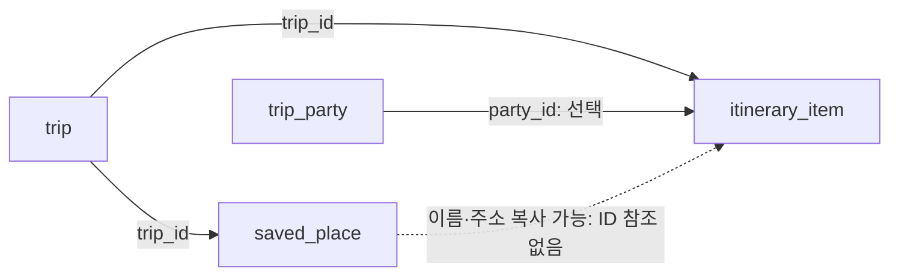

# 일정 및 장소 등록 기능 구현 계획

작성 기준: 2026-10-01 실제 MySQL 구조와 현재 프론트엔드·백엔드 코드.

후속 상태: 사용자가 저장 장소 연결 ID·좌표·메모 추가와 API·프론트엔드 연결을 승인했다. 승인된 다섯 컬럼과 FK는 마이그레이션 008로 실제 적용했다. 본문은 승인 전 조사·계획을 보존한 것이며, 현재 구현 내용과 검증 결과는 `docs/SCHEDULE-PLACE-IMPLEMENTATION.md`를 참조한다. Google 장소 ID 컬럼은 추가하지 않았다.

이 문서는 구현 전 계획이다. 실제 DB는 읽기 전용으로 조사했으며 스키마·데이터를 변경하지 않았다. 애플리케이션 코드도 변경하지 않았다. 아래 추가 컬럼은 **승인받지 않은 제안**이며, 마이그레이션을 작성하거나 실행하지 않았다.

## 1. 확인 결과와 기본 방향

현재 DB의 `saved_place`와 `itinerary_item`으로 여행별 장소·일정의 등록, 조회, 수정, 삭제를 구현할 수 있다. 화면과 입력 폼도 이미 있어 새 화면을 만드는 것보다 기존 폼을 서버 저장에 연결하는 작업이 중심이다.

다만 현재 화면이 사용하는 **일정과 저장 장소의 ID 연결, 좌표, Google 장소 ID, 메모**는 해당 테이블에 저장할 공간이 없다. 따라서 기본 등록 기능을 구현하는 데 DB 변경은 필수가 아니지만, 현재 지도·메모·장소 연결 동작을 여러 기기에서 동일하게 공유하려면 별도의 결정이 필요하다.

기본 계획은 기존 DB를 사용한다. 구현 착수 전에 아래 두 범위 중 어느 것을 목표로 할지 정한다. DB 확장은 사용자의 명시적 승인 전에는 진행하지 않는다.

| 선택 | 공유할 수 있는 내용 | 제약 |
| --- | --- | --- |
| A. 현재 DB 유지 | 장소 이름·주소·분류, 일정 제목·날짜·시간·소그룹, 일정의 장소 이름·주소 | 장소 연결은 복사본이며, 지도 좌표·메모 등을 완전히 공유할 수 없음 |
| B. 필요한 컬럼 추가 승인 후 구현 | A의 내용과 추가 승인된 필드. 전체 승인 시 정확한 장소 연결·좌표·메모·Google 장소 ID | 7절의 최소 확장 제안에 대한 사전 승인 필요 |

이전에 승인된 파티 날짜·시간 제거와 안내 문구 변경은 이미 반영된 작업이다. 이번 계획은 새로운 화면 디자인 변경을 포함하지 않는다. A에서 필요한 표시·안내 변경 범위는 실제 구현 전에 구체적으로 제시한다.

## 2. 실제 DB에서 확인한 구조

확인 방법은 `SHOW CREATE TABLE`, `information_schema`의 컬럼·외래키 조회, 행 수 조회다. 조회 당시 `saved_place`와 `itinerary_item`은 각각 0행이었다. 이는 서버 테이블의 상태이며, 기기에 저장된 기존 일정·장소가 없다는 뜻은 아니다.

### saved_place

| 컬럼 | 타입·제약 | 용도 |
| --- | --- | --- |
| `id` | BIGINT, PK, AUTO_INCREMENT | 저장 장소 ID |
| `trip_id` | BIGINT, NOT NULL, FK | 소속 여행 |
| `name` | VARCHAR(150), NOT NULL | 장소 이름 |
| `address` | VARCHAR(255), NULL 허용 | 주소 |
| `category` | VARCHAR(50), NULL 허용 | 장소 분류 |

`trip_id`에는 인덱스가 있고 `trip(id)`를 참조한다. 여행 삭제 시 장소는 CASCADE로 삭제된다. 좌표·Google 장소 ID·메모·생성/수정 시각·버전 컬럼은 없다.

### itinerary_item

| 컬럼 | 타입·제약 | 용도 |
| --- | --- | --- |
| `id` | BIGINT, PK, AUTO_INCREMENT | 일정 ID |
| `trip_id` | BIGINT, NOT NULL, FK | 소속 여행 |
| `party_id` | BIGINT, NULL 허용, FK | 지정 소그룹. NULL이면 공통 일정 |
| `title` | VARCHAR(150), NOT NULL | 일정 제목 |
| `date` | DATE, NOT NULL | 일정 날짜 |
| `start_time` | TIME, NULL 허용 | 시작 시각 |
| `end_time` | TIME, NULL 허용 | 종료 시각 |
| `place_name` | VARCHAR(150), NOT NULL | 일정에 기록한 장소 이름 |
| `address` | VARCHAR(255), NULL 허용 | 일정에 기록한 주소 |

`trip_id`, `party_id`에 각각 인덱스가 있다. 여행 삭제 시 일정은 CASCADE로 삭제되고, 소그룹 삭제 시 `party_id`는 SET NULL 처리된다. 기존 파티 API는 일정에서 사용 중인 소그룹 삭제를 먼저 거절한다.

**`itinerary_item`에는 `saved_place`를 참조하는 컬럼이나 외래키가 없다.** 두 테이블은 같은 여행에 속하지만, 현재 DB에서는 이름·주소를 복사하는 관계만 표현할 수 있다.



## 3. 현재 코드와 연결할 위치

| 영역 | 확인한 상태 | 구현 시 할 일 |
| --- | --- | --- |
| `frontend/src/features/trip/edit-screen.tsx` | 일정·장소 추가/수정/삭제 폼 구현됨 | 기존 폼과 명령 흐름 재사용 |
| `frontend/src/features/trip/planning-sections.tsx` | 목록, 소그룹 필터, 장소에서 일정 추가 구현됨 | 서버 응답을 표시하고 A에서는 장소 복사본 표시 지원 |
| `frontend/src/domain/models.ts` | Place에 좌표·메모, Agenda에 placeId·메모 존재 | 선택한 범위에 맞춰 API 모델과 도메인 모델 매핑 |
| `frontend/src/domain/commands.ts` | 날짜·시간·참조 검증, 연결 장소 삭제 방지 구현됨 | 서버 검증과 일치시키고 A/B의 장소 정책 구분 |
| `frontend/src/domain/route.ts` | agenda.placeId로 장소 좌표를 찾아 동선 구성 | B에서는 현재 연결 유지, A에서는 공유 동선 한계 처리 |
| `frontend/src/data/user-travel-repository.ts` | 장소·일정은 기기 저장소에서 복원·저장 | 실제 HTTP 모드의 서버 조회·저장 경로 추가 |
| `frontend/src/data/trip-api.ts` | 여행·멤버·소그룹 API 존재 | 장소·일정 API 메서드와 응답 타입 추가 |
| `frontend/src/data/place-search.ts` | 백엔드 Google 장소 검색 호출 구현됨 | 검색 결과를 등록 입력으로 재사용 |
| `backend/.../controller/MapsController.java` | 장소 검색과 지도 이미지 API 구현됨 | 검색 API 유지. 장소 저장 API는 별도로 구현 |
| `backend/.../tripapi/PartyService.java` | JDBC 기반 공유 CRUD·권한·중복 생성 방지 구현됨 | 같은 방식으로 장소·일정 서비스 구현 |
| `backend/.../tripapi/TripService.java` | 여행 잠금·참여 권한·보관 검사 구현됨 | 재사용하고 여행 기간 변경 시 일정 범위 검사 추가 |

`HttpTravelRepository`의 `/workspace`, `/commands` 계약이 아니라 현재 HTTP 모드에서 사용하는 `UserTravelRepository`를 연결한다. 검색 결과를 조회하는 것과 여행에 장소를 저장하는 것은 별개 작업이다.

## 4. A: DB 변경 없는 API 및 저장 계획

### API 경로

기존 Bearer JWT와 응답 형식을 사용한다. 아래는 신규 API의 제안 계약이다.

| 메서드 | 경로 | 성공 상태 | 기능 |
| --- | --- | --- | --- |
| GET | `/api/v1/trips/{tripId}/saved-places` | 200 | 저장 장소 목록 |
| GET | `/api/v1/trips/{tripId}/saved-places/{placeId}` | 200 | 장소 단건 |
| POST | `/api/v1/trips/{tripId}/saved-places` | 201 | 장소 등록 |
| PUT | `/api/v1/trips/{tripId}/saved-places/{placeId}` | 200 | 장소 전체 수정 |
| DELETE | `/api/v1/trips/{tripId}/saved-places/{placeId}` | 200 | 장소 삭제 |
| GET | `/api/v1/trips/{tripId}/itinerary-items` | 200 | 일정 목록 |
| GET | `/api/v1/trips/{tripId}/itinerary-items/{itemId}` | 200 | 일정 단건 |
| POST | `/api/v1/trips/{tripId}/itinerary-items` | 201 | 일정 등록 |
| PUT | `/api/v1/trips/{tripId}/itinerary-items/{itemId}` | 200 | 일정 전체 수정 |
| DELETE | `/api/v1/trips/{tripId}/itinerary-items/{itemId}` | 200 | 일정 삭제 |

- ID는 기존 API와 동일하게 문자열로 전송한다. BIGINT를 JavaScript Number로 변환하지 않는다.
- 성공은 `{ "code": "SUCCESS", "data": ... }`, 실패는 `{ "code": ..., "message": ... }` 형식이며 `Cache-Control: no-store`를 적용한다.
- 목록은 `{ items, nextCursor }`를 사용한다. 1차 구현은 두 목록 모두 ID 오름차순 cursor, limit 1~100으로 조회하고, 프론트엔드에서 전체 페이지를 받은 뒤 일정을 날짜·시작 시각·ID 순서로 표시한다.
- 현재 `TripStore.page()`는 timestamp 기반이다. 생성 시각이 없는 두 테이블에 그대로 사용하지 않고 ID cursor 처리를 별도로 구현한다.
- POST는 UUID `Idempotency-Key`를 받아 기존 `api_idempotency` 테이블을 사용한다. 요청 digest에는 여행 ID와 정규화한 입력을 포함한다. 생성 응답 유실 후 같은 키로 재시도하면 같은 결과를 반환한다.
- 새 Controller를 `UserApiErrors` 적용 대상에 포함한다. 여행 하위 API는 기존 `/api/v1/trips/**` 인증 설정이 보호한다.

### 저장 장소 입력

아래 값과 ID는 실제 데이터가 아닌 설명용 예시다.

```json
{
  "name": "중앙 카페",
  "address": "서울시 예시구 예시로 10",
  "category": "카페"
}
```

서버 응답은 위 저장 필드에 서버가 발급한 `id`를 포함한다. A에서는 `coordinates`, `googlePlaceId`, `note`가 서버 영속 필드가 아님을 계약에서 명확히 한다.

### 일정 입력

저장 장소를 선택했을 때의 요청 예시:

```json
{
  "title": "카페 방문",
  "date": "2026-10-04",
  "startTime": "10:00",
  "endTime": "11:00",
  "partyId": null,
  "savedPlaceId": "120"
}
```

- `savedPlaceId`는 **이름·주소를 복사하기 위한 입력**이다. 서버가 같은 여행의 장소인지 확인하고 `place_name`, `address`에 복사한다. 저장 후 응답에 지속적인 장소 참조가 있다고 표시하지 않는다.
- 이미 복사된 장소를 유지하거나 직접 입력하려면 `savedPlaceId` 대신 `placeName`, `address`를 받는 형태를 제공한다. 두 방식을 동시에 보내면 입력 오류로 처리한다.
- 장소 미지정은 선택 가능하게 유지한다. 제안은 `place_name`에 빈 문자열, `address`에 NULL을 저장하고 화면에서 “장소 미정”으로 표시하는 것이다. 실제 장소 이름으로 안내 문구를 저장하지 않는다.
- 응답 필드는 `id`, `title`, `date`, `startTime`, `endTime`, `partyId`, `placeName`, `address`다. 조회 결과만으로 정확한 `placeId`는 복원할 수 없다.
- 장소 수정·삭제 후에도 기존 일정에 복사된 이름·주소는 그대로 남는다. 일정의 장소를 다시 선택해 저장할 때 새 값을 복사한다.
- 이름·주소가 같은 장소를 자동으로 연결하지 않는다. 동명 장소·중복 등록·이름 변경을 구별할 수 없기 때문이다.
- 일정 편집은 기존 장소 복사본 유지, 다른 장소 재선택, 명시적 장소 미지정을 구분한다. 조회 응답에 `placeId`가 없다는 이유로 제목·시간만 수정했을 때 장소를 지우지 않는다. 현재 폼의 선택 상태와 저장 매핑도 이 구분에 맞춰 변경한다.

### A의 기능 한계

현재 프론트엔드는 정확한 `placeId`와 좌표를 전제로 지도와 연결 장소 삭제 방지를 제공한다. A를 선택하면 이 동작이 서버 전체에서 보장되는 것은 아니다.

일정 모델에 `placeName`·`address` 복사본을 추가해, 장소 ID가 없어도 일정 카드가 저장한 장소를 표시하도록 한다. 지도·메모·Google 장소 ID를 기기별 보조 데이터로 보존할 수는 있지만 다른 기기와 공유되는 데이터로 취급하지 않는다. 기기별 연결 정보는 다른 멤버의 일정 수정 이후에도 정확하다고 보장할 수 없다.

따라서 A에서는 장소가 삭제되어도 일정의 복사본은 유지하는 정책을 적용한다. 현재의 “연결된 장소 삭제 금지”를 모든 기기에서 유지해야 한다면 B의 장소 참조 컬럼이 필요하다. 기존 폼의 메모나 좌표를 입력받고 조용히 버리지 않으며, 기기 보관 여부와 안내 범위를 구현 전에 결정한다.

## 5. 서버 권한·검증·정합성

### 권한과 트랜잭션

1. 활성 사용자·JWT tokenVersion을 검증한다.
2. 여행 행을 잠근 뒤 현재 여행 참여자 여부를 확인한다. 기존 소그룹과 동일하게 여행 참여자 모두 등록·수정·삭제할 수 있다.
3. 보관 여행은 조회만 허용하고 쓰기는 409 `TRIP_ARCHIVED`로 거절한다.
4. 일정·장소는 항상 여행 ID와 항목 ID를 함께 조건으로 조회한다. 다른 여행의 항목이나 소그룹·장소 참조를 허용하지 않는다.
5. 사용자 → 여행 → 자식 행 순서로 잠그고, 생성·수정·삭제와 중복 생성 기록을 하나의 트랜잭션에서 처리한다.

소그룹 삭제, 여행 보관, 탈퇴와 일정 등록은 같은 여행 잠금을 사용해야 한다. 일정 등록 중 소그룹이 삭제되는 경합도 이 순서로 막는다. 기존 DB에는 작성자 컬럼이 없으므로 작성자만 수정하는 정책은 현재 계획에 포함하지 않는다.

### 입력 규칙

| 항목 | 계획 |
| --- | --- |
| 일정 제목·장소 이름 | 공백만 입력 불가. DB 최대 150자, 현재 앱 제한 100자를 1차 API에도 맞춤 |
| 주소 | DB 최대 255자. 현재 도메인의 300자 제한을 255자로 맞춰 SQL 오류 전에 안내 |
| 장소 분류 | 최대 50자. 빈 입력은 NULL로 정규화 |
| 날짜 | 엄격한 `YYYY-MM-DD`, 실제 존재하는 날짜, 여행 시작일~종료일 안 |
| 시작·종료 시각 | 새 등록·수정은 현재 폼처럼 두 값 필수, `HH:mm`, 00:00~23:59, 시작 ≤ 종료 |
| 같은 시간·겹치는 일정 | 현재 앱처럼 허용. 날짜를 넘기는 일정은 이번 범위에서 제외 |
| 소그룹 | NULL은 공통 일정, 값이 있으면 같은 여행의 존재하는 소그룹 |
| 저장 장소 선택 | 같은 여행의 존재하는 장소. 이름·주소는 서버에서 읽어 사용 |
| 좌표(B 선택 시) | 위도·경도 둘 다 있거나 둘 다 없음. 유한수, 위도 ±90·경도 ±180 |

DB의 시간 NULL은 읽을 수 있도록 처리한다. 발견 시 시간을 임의로 만들어 표시하지 않고 미지정 상태로 다룬다. 현재 서버에는 일정이 없으므로 초기 이관 대상은 없지만 테스트에서는 NULL을 포함한다. 주소도 DB에서는 NULL 가능하므로 조회는 이를 지원하고, 신규 입력은 기존 앱의 주소 필수 정책을 유지한다.

날짜·시각은 여행의 달력 날짜와 시각으로 저장한다. UTC timestamp로 임의 변환하지 않는다. MySQL TIME이 허용하는 음수·24시간 이상 값은 API에서 거절한다.

### 기존 기능과의 연동

- **여행 기간 변경:** 현재 `TripService.patch()`에는 저장 일정의 날짜 범위 검사가 없다. 서버 일정을 시작일부터 종료일까지 모두 포함하지 않는 기간 변경은 409로 거절하는 검사를 추가한다. 프론트 검증만으로는 다른 멤버가 만든 일정을 보호할 수 없다.
- **소그룹 삭제:** 일정에서 참조하는 소그룹 삭제를 막는 기존 `PartyService` 검사를 유지한다. DB의 SET NULL만으로 공통 일정으로 바뀌게 두지 않는다.
- **탈퇴:** 일정·장소는 여행 공유 데이터로 보존한다. 구성원 수가 0명이 된 소그룹도 일정 조회가 실패하지 않게 한다.
- **동시 수정:** 현재 두 테이블에는 version이 없다. 여행 잠금은 동시 실행을 직렬화하지만 오래된 화면의 덮어쓰기를 막지는 못한다. 1차 계획은 기존 소그룹과 같은 마지막 저장 우선이다. 충돌 감지가 필요하면 별도 범위로 결정한다.
- **알림:** 기기 내 `applyCommand`가 만드는 알림을 서버 알림으로 간주하지 않는다. 이번 범위는 CRUD와 재조회이며 푸시·실시간 동기화는 포함하지 않는다.

## 6. 프론트엔드 연결과 기존 기기 데이터

1. `TripApi`에 장소·일정의 목록/단건/생성/수정/삭제와 타입을 추가한다.
2. `UserTravelRepository.load()`에서 여행별 멤버·소그룹·장소·일정을 조회한다. 독립 요청은 병렬 처리한다.
3. `places`, `agenda`를 `localCollections`의 전체 배열 복원 대상에서 제외한다. 과거 기기 배열로 서버 목록을 덮어쓰지 않는다.
4. 기존 `item.save`, `item.delete` 명령을 서버 API로 분기한다. 생성은 서버 ID를 사용하며, 성공 뒤 재조회 결과를 반영한다.
5. 생성 재시도 키는 생성 응답이나 후속 조회가 실패해도 같은 입력에 재사용한다. 세션·사용자 전환 시 다른 사용자의 보조 데이터가 섞이지 않도록 검사한다.
6. A에서는 서버 저장 필드와 기기 보조 필드를 분리한다. 신규 등록의 메모·좌표를 보존한다면 생성 응답의 서버 ID로 보조 정보를 연결한 뒤 재조회한다. 응답 유실 후 재시도도 같은 서버 ID로 복구한다. B에서는 승인된 필드만 서버 영속 필드에 매핑하고, 미승인 필드는 A의 정책을 따른다.
7. 공통 일정은 `partyId=null`만 표시하고, 소그룹 화면은 공통 일정과 선택 소그룹 일정을 함께 표시하는 현재 규칙을 유지한다.

A의 보조 정보에는 마지막으로 확인한 서버 장소 이름·주소와 일정 장소 복사본도 기록한다. 다음 조회에서 이 값이 달라지면 기기의 장소 연결·좌표를 무효화하고 사용자 재선택 전까지 동선에 사용하지 않는다. 이름·주소가 완전히 같은 다른 장소로 바뀐 경우에는 변경을 탐지할 수 없으므로, 이 비교를 정확한 연결의 보장으로 취급하지 않는다.

기존 기기 데이터는 원본을 남긴다. 자동 업로드는 하지 않으며, 서버 등록 데이터와 오래된 기기 데이터를 혼합하지 않는다. 필요하면 별도 이관 기능을 계획한다. 이관 시에는 장소를 먼저 생성하고 **기기 장소 ID → 서버 장소 ID** 변환표로 일정의 참조를 바꿔야 한다. A에서 저장하지 못하는 메모·좌표도 원본에서 사라지면 안 된다.

새 일정·장소의 서버 공유를 안내하는 문구와 A의 기기 보관 범위를 구체적으로 정한다. 기존 안내 변경 승인을 이번 기능의 모든 UI 변경 허가로 확대해 해석하지 않는다.

## 7. B: 전체 공유를 위한 DB 확장 제안 — 미승인

기존 장소 선택·지도·메모 동작을 기기 간에도 유지하려는 경우에만 아래 변경을 제안한다. **실행 여부와 정확한 타입·제약은 사용자 승인 후 확정한다.**

| 테이블 | 추가 제안 | 목적 |
| --- | --- | --- |
| `saved_place` | `latitude DECIMAL(10,7) NULL` | 지도 위치의 위도 |
| `saved_place` | `longitude DECIMAL(10,7) NULL` | 지도 위치의 경도 |
| `saved_place` | `google_place_id VARCHAR(255) NULL` | 검색 결과의 외부 장소 ID |
| `saved_place` | `note TEXT NULL` | 장소 메모 |
| `itinerary_item` | `saved_place_id BIGINT NULL` + FK | 정확한 저장 장소 연결 |
| `itinerary_item` | `note TEXT NULL` | 일정 메모 |

여섯 컬럼은 현재 UI에서 이미 쓰는 필드의 저장 공간을 제안한 것이다. 모두 추가해야 기본 등록이 가능한 것은 아니다. 정확한 장소 연결만 공유하려면 `saved_place_id`만, 연결과 지도까지 공유하려면 참조와 좌표 컬럼만 승인하는 식으로 범위를 나눌 수 있다. Google 장소 ID는 재검색·재조회용이며 좌표 기반 지도 표시에 필수는 아니다.

- 장소 참조는 같은 여행의 장소인지 서버에서도 검사한다. 단순 장소 FK만으로 여행 간 참조를 막을 수는 없다.
- 장소 참조 FK는 기존 소그룹처럼 `ON DELETE SET NULL`을 기본 제안으로 하고, API는 연결 일정이 있으면 409 `PLACE_IN_USE`로 삭제를 거절한다. 여행 잠금으로 일정 등록과 장소 삭제를 직렬화해 현재 화면의 삭제 방지 정책을 유지한다. DB를 직접 조작하는 삭제는 API 검사를 우회하므로 FK만으로 삭제 금지를 보장하는 정책은 아니다. 승인 후 별도 테스트 DB에서 기존 여행 CASCADE와 함께 검증한다.
- 연결된 장소의 이름·주소 수정은 일정 화면에도 반영하는 현재 동작을 유지한다. 조회에서는 연결된 장소 값을 우선하고, `place_name/address` 복사본도 같은 트랜잭션에서 일관되게 갱신한다. 연결 해제 시에는 미지정/직접 입력 정책에 맞춰 저장한다.
- 좌표가 둘 다 NULL이면 현재처럼 지도에 위치를 만들지 않는다. 주소 재검색으로 임의의 좌표를 확정하지 않는다.
- 메모는 API와 폼에 같은 길이 제한을 적용한다. 제안 한도는 3,000자이며 기존 기기 메모가 넘으면 자르지 않고 이관 전 안내한다.
- 주소·분류 등 기존 컬럼에 JSON이나 구분자를 숨겨 저장하는 방식은 사용하지 않는다.
- 생성/수정 시각·version 컬럼은 이번 기능에 필수인 변경으로 제안하지 않는다.

승인 후에는 적용 SQL, 기존 데이터 처리, 제약 검증, 복구 절차를 먼저 검토 가능한 형태로 준비한다. DB 변경 승인을 받았다고 임의로 다른 컬럼이나 제약을 추가하지 않는다. 현재 테이블이 비어 있다는 이유만으로 무단 변경하지 않는다.

## 8. 구현 순서와 완료 기준

| 단계 | 작업 | 완료 기준 |
| --- | --- | --- |
| 1 | A/B와 공유 범위 확정 | 장소 연결·지도·메모·삭제 정책 결정. DB 변경 필요 시 명시적 승인 확보 |
| 2 | 장소 API 구현 | 여행별 장소 CRUD, 권한·보관·길이 검증, 중복 생성 방지 |
| 3 | 일정 API 구현 | 날짜·시간·소그룹·장소 입력 검증, 일정 CRUD, 여행 기간 변경 연동 |
| 4 | 저장소 연결 | 기존 폼으로 서버 저장·재조회, 서버 배열 보호, 원본 기기 데이터 보존 |
| 5 | 장소 표시·지도 연동 | A의 복사본 표시 또는 B의 정확한 연결, 공통/소그룹 필터 정상 동작 |
| 6 | 통합 검증 | 아래 주요 시나리오 통과 후 구현 결과 문서 갱신 |

### 필요한 검증

별도 테스트 DB에서 실제 스키마를 재현해 검증한다. 실사용 DB에 테스트 여행·일정·장소를 만들지 않는다. 현재 H2 fixture에는 전체 `saved_place` 구조가 없으므로 선택한 계약에 맞는 fixture를 준비한다.

- 같은 여행의 두 계정이 서로의 장소·일정 CRUD 결과를 재조회할 수 있다.
- 비로그인·탈퇴·외부 사용자, 다른 여행의 일정/장소/소그룹 ID를 차단한다.
- 보관 여행은 조회 가능하고 등록·수정·삭제는 차단된다.
- 여행 날짜 범위, 존재하지 않는 날짜, 시간 형식·역전, 주소 255자 경계, 이름·분류 길이를 검증한다.
- NULL 선택 필드와 장소 미지정 일정, 빈 소그룹, 같은 시각·겹치는 일정이 결정한 정책대로 처리된다.
- 같은 생성 키 재시도는 중복 행을 만들지 않으며, 다른 입력에 같은 키를 쓰면 409를 반환한다.
- 소그룹 삭제와 일정 생성, 여행 보관과 등록, 탈퇴와 쓰기 경합에서 참조나 권한이 깨지지 않는다.
- 여행 기간 축소로 기존 일정이 기간 밖으로 나가면 거절한다.
- A에서는 장소 수정·삭제 후 일정 복사본을 보존한다. B에서는 연결 장소 삭제를 거절하고 장소 수정이 일정에 반영된다.
- A에서 제목·시간만 수정해도 기존 장소 복사본이 남고, 명시적 장소 변경·미지정만 해당 값을 바꾼다.
- 여러 페이지 조회, 같은 날짜·시간, NULL 시간에서도 목록이 누락되거나 중복되지 않는다.
- 생성 응답 유실·후속 조회 실패·세션 전환 시 중복 생성이나 계정 간 데이터 혼합이 없다.
- 기기 보조 정보가 신규 서버 ID로 복구되고, 다른 멤버가 장소나 일정의 위치를 변경했을 때 오래된 좌표로 지도 핀·동선을 만들지 않는다.
- 과거 기기 배열이 서버 배열을 덮어쓰지 않고, 기존 메모·좌표 원본이 보존된다.
- 공통/소그룹 일정 표시와 지도 동선, 장소 검색·수동 입력 동작이 선택한 범위와 일치한다.
- B 승인 시 여행 삭제 CASCADE와 장소 FK의 동작을 별도 DB에서 확인한다.

계획 작성 과정에서는 테스트를 실행하지 않았다. 구현 후 백엔드 통합 테스트, 프론트엔드 도메인·저장소 테스트, 타입 검사와 주요 화면 동작을 검증한다.

## 9. 구현 전 결정할 사항

기본 등록·공유만 목표라면 A로 진행할 수 있다. 기존 지도·메모와 정확한 장소 연결까지 공유하려면 B의 필요한 컬럼을 개별적으로 승인받는 방향을 권장한다.

아직 결정하지 않은 사항은 다음과 같다.

1. 저장 장소와 일정의 관계를 복사본(A)으로 사용할지, 정확한 연결(B)으로 유지할지.
2. 좌표·Google 장소 ID·일정/장소 메모를 서버 공유 범위에 포함할지.
3. A를 선택할 때 기존 입력·안내·삭제 동작을 어디까지 조정할지.
4. 기존 기기 데이터의 이관이 필요한지. 기본은 원본 보존, 자동 업로드 없음.

현재 완료한 작업은 DB·코드 조사와 이 계획 문서 작성까지다. API 구현, UI 변경, DB 변경은 아직 진행하지 않았다.
