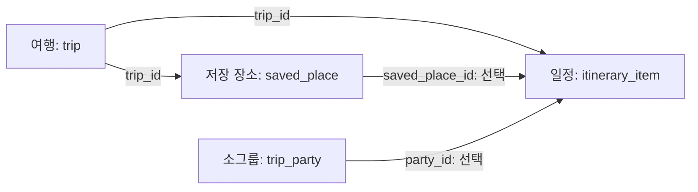

# 일정·장소 등록 기능 구현 정리

> **상태: 구현 완료 · DB 적용 완료**
>
> 작성 기준: 2026-10-01 구현 및 검증 결과

## 1. 변경 내용 한눈에 보기

일정과 장소를 **여행 멤버가 함께 사용하는 서버 데이터**로 연결했다. 기존 등록 폼, 목록, 소그룹 필터, 지도 배치를 재사용한다.

| 항목 | 변경 전 | 변경 후 |
| --- | --- | --- |
| 장소 등록·수정·삭제 | 현재 기기에 저장 | 서버에 저장하고 여행 멤버와 공유 |
| 일정 등록·수정·삭제 | 현재 기기에 저장 | 서버에 저장하고 여행 멤버와 공유 |
| 일정의 장소 연결 | 기기 안의 장소 ID로 연결 | DB의 저장 장소 ID와 외래키로 연결 |
| 지도 좌표 | 기기에 보관 | 장소 위도·경도를 서버에 저장 |
| 일정·장소 메모 | 기기에 보관 | 서버에 저장하고 재조회 시 복원 |
| 연결된 장소 삭제 | 기기 데이터 기준 검사 | 서버가 연결 일정을 확인하고 삭제 차단 |

**공유 방식:** 저장 성공 후 서버를 다시 조회해 최신 데이터를 반영한다. 실시간 푸시·자동 갱신 기능은 이번 변경에 포함하지 않았다.

| 현재 저장 범위 | 데이터 |
| --- | --- |
| 서버에서 여행 멤버와 공유 | 여행 정보·멤버·소그룹·일정·장소·장소 좌표·일정/장소 메모 |
| 현재 기기에 저장 | 정산·준비물·공지·대화 |

과거 기기 일정·장소는 원본을 보존하며 서버 목록에 자동 이관하지 않는다.

## 2. 실제 적용한 DB 변경

사용자 승인 후 **컬럼 5개**를 실제 MySQL에 추가했다.

| 테이블 | 추가 컬럼 | 타입 | 용도 |
| --- | --- | --- | --- |
| `saved_place` | `latitude` | `DECIMAL(10,7) NULL` | 장소 위도 |
| `saved_place` | `longitude` | `DECIMAL(10,7) NULL` | 장소 경도 |
| `saved_place` | `note` | `TEXT NULL` | 장소 메모 |
| `itinerary_item` | `saved_place_id` | `BIGINT NULL` | 연결한 저장 장소 ID |
| `itinerary_item` | `note` | `TEXT NULL` | 일정 메모 |

마이그레이션: [008-schedule-saved-places.sql](C:/Programings/2026_2_창의학기제/backend/db/migrations/008-schedule-saved-places.sql)

### 장소 연결 관계



- `saved_place_id`에 `idx_itinerary_saved_place` 인덱스를 추가했다.
- `fk_itinerary_saved_place` 외래키가 `saved_place(id)`를 참조한다.
- 외래키의 삭제 규칙은 `ON DELETE SET NULL`이다. **앱의 장소 삭제는 API가 먼저 검사하여 연결 일정이 있으면 거절한다.**
- 기존 여행·소그룹 외래키와 나머지 컬럼은 유지했다.
- Google 장소 ID, 생성·수정 시각, 버전 컬럼은 추가하지 않았다.

### 적용 확인

| 확인 항목 | 결과 |
| --- | --- |
| 변경 전 스키마 | `SHOW CREATE TABLE` 결과를 로컬 임시 파일로 보관 |
| 변경 후 스키마 | 5개 컬럼의 타입·외래키·SET NULL 규칙 확인 |
| 기존 행 수 | 두 테이블 각각 0행 → 0행 유지 |
| 기존 데이터 처리 | 업데이트·삭제·이름 기반 자동 연결 없음 |

이 마이그레이션은 현재 DB에 **이미 적용했다**. 같은 DB에 다시 실행하지 않는다. MySQL DDL은 암묵적으로 커밋하므로 두 ALTER를 하나의 롤백 가능한 트랜잭션으로 취급하지 않는다. 다른 환경에서 적용이 실패했다면 실제 스키마를 확인한 뒤 남은 변경을 결정한다.

## 3. 사용 흐름과 주요 동작

### 장소를 등록하고 일정에 연결하기

1. Google 장소 검색 또는 직접 입력으로 장소를 등록한다.
2. 서버가 장소 이름·주소·분류·좌표·메모를 저장하고 ID를 발급한다.
3. 일정 폼에서 저장 장소와 소그룹을 선택한다. 소그룹을 선택하지 않으면 공통 일정이다.
4. 서버가 여행 기간, 시간, 장소·소그룹의 소속 여행을 확인해 일정을 저장한다.
5. 앱이 서버 데이터를 다시 조회하여 목록·지도·메모를 표시한다.

### 수정·삭제·지도 표시 규칙

| 상황 | 처리 |
| --- | --- |
| 연결 장소의 이름·주소 수정 | 연결 일정의 장소 이름·주소 복사본도 같은 트랜잭션에서 갱신 |
| 일정에서 사용 중인 장소 삭제 | `409 PLACE_IN_USE`로 거절. 일정의 연결을 먼저 해제하거나 일정 삭제 필요 |
| 일정에서 사용 중인 소그룹 삭제 | 기존 `409 PARTY_IN_USE` 검사 유지 |
| 여행 기간 변경으로 기존 일정이 기간 밖으로 나감 | `409 ITINERARY_OUTSIDE_TRIP_DATES`로 거절 |
| 보관된 여행 | 조회 허용, 신규 등록·수정·삭제 차단 |
| 장소 좌표 없음 | 지도에 임의의 위치나 동선 연결선을 만들지 않음 |
| 기존 일정의 시각이 NULL | “시간 미정”으로 표시하고 해당 구간의 동선 연결 생략 |
| 여러 멤버가 같은 항목 수정 | 여행 잠금으로 동시 실행을 순서대로 처리. 오래된 화면의 수정은 마지막 저장 우선 |

## 4. API 계약

기본 경로는 `/api/v1/trips/{tripId}`다. 모든 요청은 기존 **Bearer JWT** 인증을 사용한다.

| 기능 | 메서드 | 장소 경로 | 일정 경로 | 성공 상태 |
| --- | --- | --- | --- | --- |
| 목록 조회 | GET | `/saved-places` | `/itinerary-items` | 200 |
| 단건 조회 | GET | `/saved-places/{placeId}` | `/itinerary-items/{itemId}` | 200 |
| 등록 | POST | `/saved-places` | `/itinerary-items` | 201 |
| 전체 수정 | PUT | `/saved-places/{placeId}` | `/itinerary-items/{itemId}` | 200 |
| 삭제 | DELETE | `/saved-places/{placeId}` | `/itinerary-items/{itemId}` | 200 |

### 공통 응답·페이지 조회

- 성공: `{ "code": "SUCCESS", "data": ... }`
- 오류: `{ "code": ..., "message": ... }`
- 삭제 성공 시 `data`는 `null`이다.
- 목록 `data`는 `{ "items": [...], "nextCursor": ... }`다.
- `limit`은 1~100이며 ID 오름차순 cursor를 사용한다. 앱은 모든 페이지를 받은 뒤 날짜·시간·ID 순서로 일정을 표시한다.
- 모든 ID는 BIGINT 정밀도를 유지하도록 **문자열**로 전송한다.
- 응답에 `Cache-Control: no-store`를 적용한다.

### 장소 등록·수정 요청 예시

```json
{
  "name": "중앙 카페",
  "address": "서울시 예시구 예시로 10",
  "category": "카페",
  "note": "입구에서 만나기",
  "coordinates": {
    "latitude": 37.5665,
    "longitude": 126.978
  }
}
```

응답에는 위 필드와 서버 발급 `id`가 포함된다. 위치 미지정은 `coordinates: null`로 보낸다. Google 장소 ID는 서버 요청에 포함하지 않는다.

### 일정 등록·수정 요청 예시

아래 날짜·ID는 설명용 예시이며, 실제 요청의 날짜는 해당 여행 기간 안이어야 한다.

```json
{
  "title": "카페 방문",
  "date": "2026-10-04",
  "startTime": "10:00",
  "endTime": "11:00",
  "placeId": "120",
  "partyId": null,
  "note": "예약 확인"
}
```

응답에는 위 필드와 `id`, `placeName`, `address`가 포함된다.

| 필드 | 의미 |
| --- | --- |
| `placeId` | DB의 `saved_place_id`. `null`이면 장소 미지정 |
| `partyId` | 소그룹 ID. `null`이면 공통 일정 |
| `placeName`, `address` | 서버가 선택한 장소에서 읽어 저장한 표시용 복사본 |

### 권한·입력 검증

| 항목 | 규칙 |
| --- | --- |
| 접근 권한 | 활성 계정과 현재 여행 참여 여부, JWT tokenVersion 확인 |
| 참조 범위 | 다른 여행의 일정·장소·소그룹 ID 차단 |
| 제목·장소 이름 | 공백만 입력 불가, 1~100자 |
| 주소 | 공백만 입력 불가, 1~255자 |
| 장소 분류 | 최대 50자. 빈 입력 가능 |
| 일정·장소 메모 | 최대 3,000자. 공백·줄바꿈 원문 보존 |
| 날짜 | 실제 존재하는 `YYYY-MM-DD`, 여행 시작일~종료일 안 |
| 새 일정의 시간 | 시작·종료 모두 필수. `HH:mm`, 00:00~23:59, 시작 ≤ 종료 |
| 같은 시각·겹치는 일정 | 허용. 날짜를 넘기는 일정은 지원하지 않음 |
| 좌표 | 두 값이 모두 있거나 모두 없음. 위도 ±90·경도 ±180의 유한수, 소수점 7자리 저장 |

날짜·시간은 달력 날짜와 시각으로 저장하며 UTC timestamp로 변환하지 않는다. DB의 기존 NULL 시간·주소·메모 등은 조회 시 처리한다.

### 중복 생성 방지와 재시도

POST에는 UUID 형식의 `Idempotency-Key`가 필수다. 기존 `api_idempotency` 테이블에 사용자·작업·키·입력 digest·응답을 저장한다.

| 요청 상황 | 처리 |
| --- | --- |
| 같은 입력·같은 키 재시도 | 24시간 동안 기존 생성 응답 반환, 새 행 생성 없음 |
| 다른 입력에 같은 키 사용 | `409 IDEMPOTENCY_KEY_REUSED` |
| 성공 후 여행 보관·참조 장소/소그룹 변경 또는 삭제 | 현재 여행 참여 권한 확인 후 기존 응답 재생 |
| 여행 참여 권한 상실 | 기존 요청의 재시도도 차단 |

재생 응답은 **처음 생성됐을 당시의 결과**다. 앱은 후속 재조회로 현재 상태를 표시한다. 참조 검사·저장·재시도 기록은 같은 트랜잭션에서 처리하고, 잠금 순서는 사용자 → 여행 → 자식 행이다.

## 5. 프론트엔드 연결과 데이터 보존

### 서버 연결

- `TripApi`에 장소·일정 CRUD와 응답 타입을 추가했다.
- 실제 HTTP 모드의 `UserTravelRepository`가 여행별 멤버·소그룹·장소·일정을 조회한다.
- 기존 폼의 `item.save`, `item.delete` 명령을 서버 API로 연결했다.
- `places`, `agenda`를 기기 배열 복원 대상에서 제외하여 과거 배열이 서버 목록을 덮어쓰지 않게 했다.
- 저장 성공 후 서버를 재조회하여 실제 서버 ID와 공유 데이터를 반영한다.
- 저장 안내 문구를 일정·장소가 공유되는 내용에 맞췄다. 공통/소그룹 필터와 지도 배치는 유지했다.

### 생성 응답 유실·세션 전환 처리

같은 로그인 세션에서 동일 입력의 생성 요청이 실패하면 재시도 키를 메모리에 유지한다. 이미 기록된 키가 있는 생성 재시도는 서버가 권한과 재생 여부를 판단하도록 한다. 일반 신규·수정·삭제는 기존 도메인 검증을 유지한다.

성공한 재시도 뒤 같은 내용을 별도로 새로 등록하면 새 키를 사용한다. 로그인 전환·로그아웃 시 기존 키를 초기화하여 계정 간 데이터가 섞이지 않게 한다.

재시도 키는 해당 저장소 인스턴스의 메모리에만 보관한다. 앱 재실행·브라우저 새로고침으로 인스턴스가 새로 만들어지면 새 키를 사용한다.

### 기존 데이터와 예외 처리

| 항목 | 처리 |
| --- | --- |
| 과거 기기 일정·장소 | 원본 보존. 삭제·자동 업로드 없음 |
| 서버 전환 후 과거 기기 데이터 표시 | 서버 목록에 자동 혼합하지 않음. 필요하면 별도 이관 작업 필요 |
| 기기 데이터 이관 | 장소 ID 변환표를 만들고 일정 참조를 함께 변경해야 함 |
| Google 장소 ID | 이번 DB 추가 범위에서 제외. 과거 기기 원본은 유지 |
| 새 Google 검색 결과 | 이름·주소·좌표를 서버에 저장하여 지도에 사용 |
| 장소 ID 없는 기존 일정 복사본 | 이름·주소 표시 가능. 편집 시 장소 재연결 또는 명시적 “장소 미정” 선택 요구 |

API의 PUT에서 `placeId: null`을 보내면 장소 연결과 복사본을 함께 해제한다. 편집 폼의 선택 확인은 제목·시간만 수정하다 기존 장소 복사본이 조용히 사라지는 것을 막는다.

DB를 직접 조작해 장소를 삭제하면 API의 삭제 검사를 우회한다. 이때 외래키는 일정의 연결 ID를 NULL로 바꾸고 장소 이름·주소 복사본은 보존한다.

## 6. 주요 변경 파일

| 영역 | 파일 | 역할 |
| --- | --- | --- |
| DB | [008-schedule-saved-places.sql](C:/Programings/2026_2_창의학기제/backend/db/migrations/008-schedule-saved-places.sql) | 승인된 컬럼·인덱스·외래키 추가 |
| 백엔드 API | [PlaceController.java](C:/Programings/2026_2_창의학기제/backend/src/main/java/com/travel/travelbackend/controller/PlaceController.java), [ItineraryController.java](C:/Programings/2026_2_창의학기제/backend/src/main/java/com/travel/travelbackend/controller/ItineraryController.java) | 장소·일정 HTTP 엔드포인트 |
| 백엔드 저장 | [PlaceService.java](C:/Programings/2026_2_창의학기제/backend/src/main/java/com/travel/travelbackend/tripapi/PlaceService.java), [ItineraryService.java](C:/Programings/2026_2_창의학기제/backend/src/main/java/com/travel/travelbackend/tripapi/ItineraryService.java) | CRUD·검증·참조·삭제 보호 |
| 백엔드 공통 | [PlanningSupport.java](C:/Programings/2026_2_창의학기제/backend/src/main/java/com/travel/travelbackend/tripapi/PlanningSupport.java) | 접근 검사·재시도·ID cursor |
| 여행 기간 검증 | [TripService.java](C:/Programings/2026_2_창의학기제/backend/src/main/java/com/travel/travelbackend/tripapi/TripService.java) | 기존 일정을 벗어나는 기간 변경 차단 |
| 오류 응답 | [UserApiErrors.java](C:/Programings/2026_2_창의학기제/backend/src/main/java/com/travel/travelbackend/userapi/UserApiErrors.java) | 새 Controller에 기존 오류 형식 적용 |
| 프론트 API | [trip-api.ts](C:/Programings/2026_2_창의학기제/frontend/src/data/trip-api.ts) | API 메서드·DTO |
| 프론트 저장소 | [user-travel-repository.ts](C:/Programings/2026_2_창의학기제/frontend/src/data/user-travel-repository.ts) | 서버 조회·저장·재시도·기기 원본 보존 |
| 프론트 도메인 | [models.ts](C:/Programings/2026_2_창의학기제/frontend/src/domain/models.ts), [commands.ts](C:/Programings/2026_2_창의학기제/frontend/src/domain/commands.ts), [route.ts](C:/Programings/2026_2_창의학기제/frontend/src/domain/route.ts) | 표시용 복사본·입력 검증·일정 정렬·동선 |
| 프론트 화면 | [edit-screen.tsx](C:/Programings/2026_2_창의학기제/frontend/src/features/trip/edit-screen.tsx), [planning-sections.tsx](C:/Programings/2026_2_창의학기제/frontend/src/features/trip/planning-sections.tsx), [schedule-map.tsx](C:/Programings/2026_2_창의학기제/frontend/src/features/trip/schedule-map.tsx), [trip-screen.tsx](C:/Programings/2026_2_창의학기제/frontend/src/features/trip/trip-screen.tsx) | 편집 보호·미지정 값 표시·공유 안내 |
| 테스트 | [PlanningApiTests.java](C:/Programings/2026_2_창의학기제/backend/src/test/java/com/travel/travelbackend/PlanningApiTests.java), [test-app.cjs](C:/Programings/2026_2_창의학기제/frontend/scripts/test-app.cjs) | API·저장소·도메인·재시도 회귀 검증 |

테스트 스키마인 `party-schema.sql`, `application-test.properties`와 기존 `PartyApiTests`의 준비 데이터 정리도 변경된 구조에 맞췄다.

## 7. 검증 결과와 실행 시 참고

아래는 **구현 완료 당시의 실행 결과**다. 이번 문서 정리 과정에서는 기능 테스트를 다시 실행하지 않았다.

| 검증 | 결과 |
| --- | --- |
| 실제 MySQL 변경 후 메타데이터 조회 | 승인된 5개 컬럼·외래키·SET NULL 확인, 기존 행 수 유지 |
| 백엔드: `gradlew.bat test --console=plain` | **58개 통과**, 실패·오류 0개. 신규 Planning API 테스트 18개 |
| 프론트: `npm test` | **83개 통과** |
| 프론트: `npm run typecheck` | 통과 |
| 프론트: `npm run build:web` | Expo 웹 빌드 통과 |
| 변경 파일: `git diff --check` | 통과 |

### 확인한 주요 시나리오

- 여행 멤버 간 CRUD 공유, 좌표·메모·장소·소그룹 연결.
- 다른 여행 접근, 보관 여행 쓰기, 잘못된 날짜·시간·길이·참조 차단.
- 여행 기간 축소와 장소·소그룹 삭제 보호.
- 생성 재시도 중복 방지, 응답 유실·재조회 실패·세션 전환 처리.
- 등록과 삭제·기간 변경·보관·탈퇴의 동시 실행, 중간 실패 롤백.
- 직접 장소 삭제 시 SET NULL과 복사본 보존, 여행 삭제 CASCADE.
- 기기 원본 보존, 서버 배열 보호, 페이지 조회·토큰 갱신·미지정 시간의 지도 처리.

### 검증 환경 및 적용 범위

백엔드 기능 테스트는 **격리된 H2**에서 실행했다. 외래키·CASCADE 동작 역시 H2 검증 결과이며 실제 MySQL 데이터로 CRUD를 실행한 결과는 아니다. 실제 DB에는 기능 테스트용 데이터를 만들지 않았다.

브라우저에서 실제 서버에 로그인해 화면을 클릭하는 수동 검증은 수행하지 않았다. 기존 백엔드가 실행 중이면 **재시작하여 새 API 코드를 반영**해야 한다.
